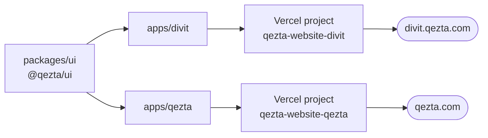

    

        
        <h1 align='center'>qezta-website</h1>
        <strong>Qezta Website</strong>
    

---

    
    
    
    
    
    

---

    
    

---

## Contents

- [Overview](#overview)
- [Structure](#structure)

---

## Overview

My personal website: <a href="https://divit.qezta.com/" target="_blank" alt="personal-website">divit.qezta.com</a>

Under development Qezta website: <a href="https://qezta.com/" target="_blank" alt="Qezta-website">www.Qezta.com</a>

## Structure

This monorepo is what Vercel deploys for both sites.

| Path | Deployed as |
| --- | --- |
| `apps/divit` | [divit.qezta.com](https://divit.qezta.com) (Vercel project `qezta-website-divit`) |
| `apps/qezta` | [qezta.com](https://qezta.com) (Vercel project `qezta-website-qezta`) |
| `packages/ui` | Shared Svelte components and styles (`@qezta/ui`) |

[![][back-to-top]](#top)

[back-to-top]: https://img.shields.io/badge/-BACK_TO_TOP-151515?style=flat-square&color=purple
